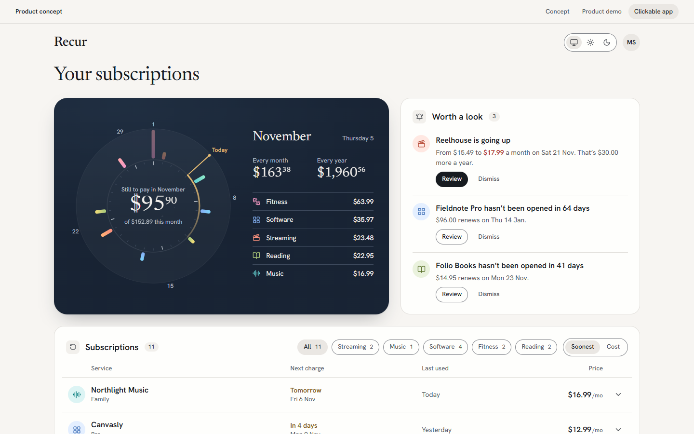
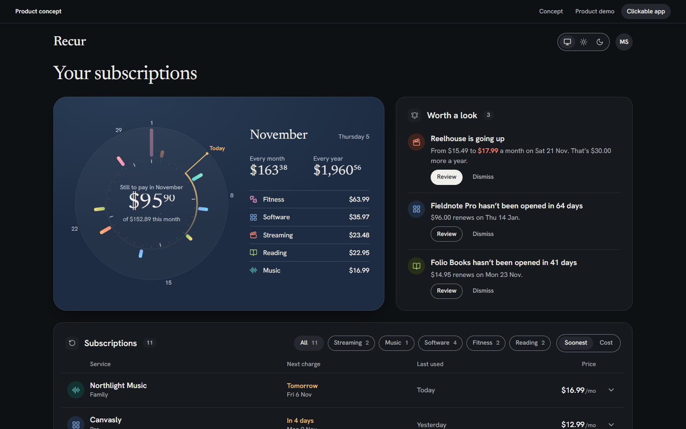
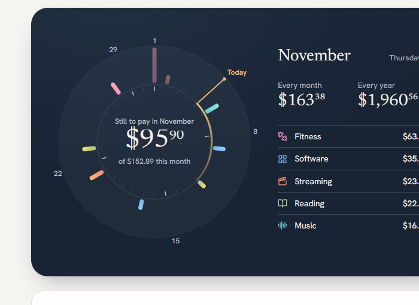
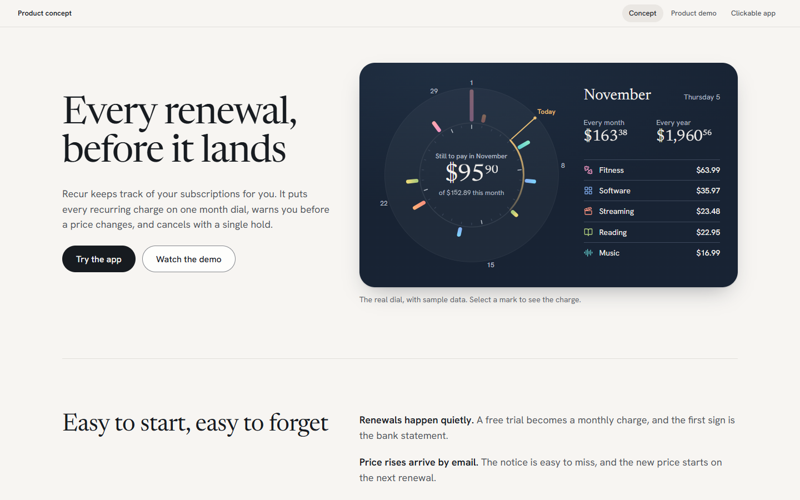
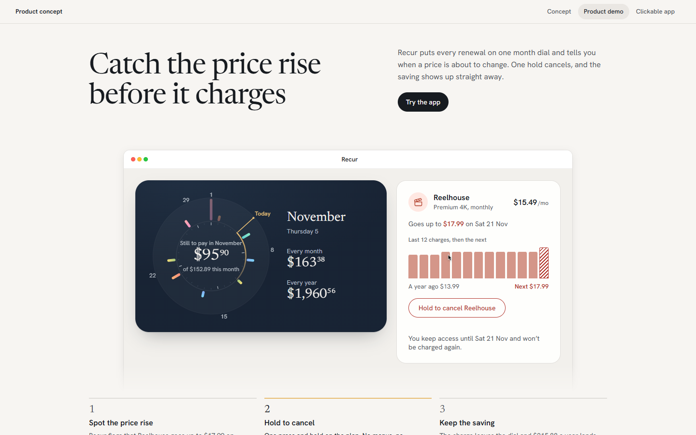

# Recur

**A subscription tracker built around one month dial.** Recur shows every recurring charge on a dial of the month,
warns you before a price changes, and cancels a plan with one press-and-hold.



## What it is

One page with three views, switched by the strip at the top or the address hash:

- **Concept** (`#concept`): the product idea, the dial and the design reasoning.
- **Demo** (`#demo`): a self-playing product demo built from the app's real components.
- **App** (`#app`): the clickable screen. The month dial (each renewal a mark on its day, length by cost, colour by
  category, a brass hand at today), "Worth a look" insights (price rises, plans you haven't opened), the subscription
  list with history bars, hold to cancel with an 8-second undo, and restore. Light and dark themes.

## Who it's for

People with eight to fifteen subscriptions who check them about once a week and want to catch a price rise or an
unused plan before it charges.

## Status

A design **prototype**. The data is a fixed sample (11 invented services in USD, with "today" set to Thursday
5 November 2026); there is no bank or email connection, and how Recur would learn usage and price changes is not
designed. Cancelling only changes the on-screen sample. Not yet tested on a real iPhone or with a screen reader; see
[design-notes/recur.md](design-notes/recur.md) for the checks that were run and what is open.

## Privacy

Everything runs in your browser and nothing is sent to a server. The only thing stored is your theme choice (browser
local storage). All services, prices, card endings and usage figures are invented sample data.

## Built with

React 18, TypeScript, Vite 6, lucide-react icons. Fonts: Hanken Grotesk and Newsreader (Google Fonts). The demo uses a
small demo kit of my own, vendored in `app/src/kit/`; `app/src/recipes/` holds my reusable interaction pieces
(hold to confirm, morph button, motion tokens).

## Run it

```sh
cd app && npm install && npm run dev
```

Then open http://127.0.0.1:5210/ (add `#app` or `#demo` for the other views). `npm run build` type-checks and builds to
`app/dist/`. `?theme=light|dark` forces a theme for one load.

**Single-file page:** `publish/recur-local.html` opens in a browser on its own (fonts need internet); `publish/recur.html`
is the same page without the `<html>`/`<head>` wrapper, for embedding. To rebuild both: `npm run build` in `app/`, then
`python -I package.py` here.

## Screenshots

| | |
|---|---|
|  |  |
|  |  |

More: [app on a phone](docs/screenshots/app-390.png) · [full concept page](docs/screenshots/concept-1440-full.png)

## How it was designed

- [design-notes/direction.md](design-notes/direction.md): the concept, the five lines and the direction
  "Instrument on porcelain", with the candidates that were considered.
- [design-notes/recur.md](design-notes/recur.md): the decision, assumptions, applied rules, checks, review and what was
  not checked.

## Licence

MIT, see [LICENSE](LICENSE). Copyright (c) 2026 Ankeet Panda.

## Third-party notices

- Icons: [Lucide](https://lucide.dev) (ISC licence), via `lucide-react`; also inlined in `publish/*.html`.
- Fonts: Hanken Grotesk and Newsreader, SIL Open Font License 1.1, loaded from Google Fonts at runtime (not bundled).
- npm packages keep their own licences (React and React DOM: MIT).

Full third-party licence texts are in [licenses/](licenses/).
